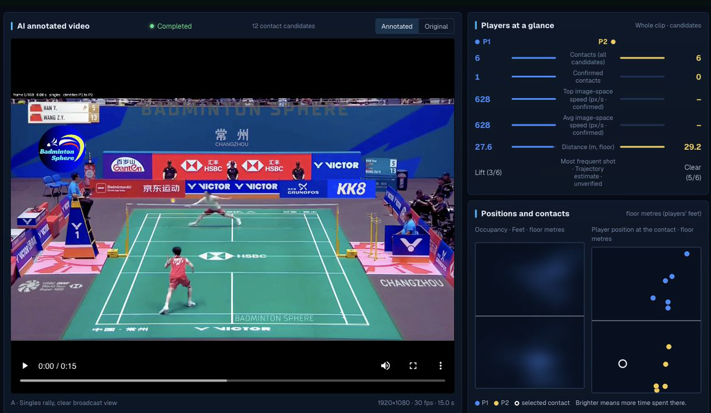
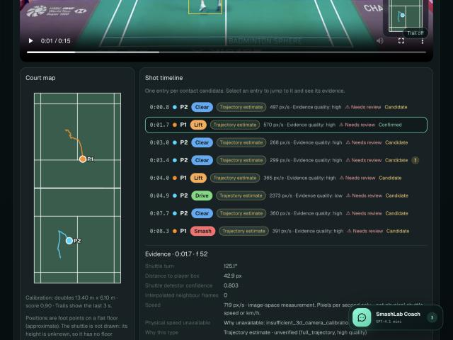
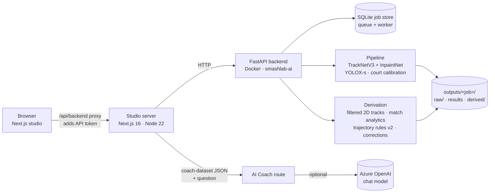

# SmashLab

SmashLab analyses badminton clips on your computer. Its Docker backend tracks the shuttle and players, then produces an annotated replay, a shot timeline and frame-level evidence. The optional AI Coach uses derived analysis data to answer questions about the selected session.


*Walkthrough of a saved Sample A analysis in the current studio.*

| Results dashboard | Timeline and shot evidence |
|---|---|
|  |  |

Sample A footage in the walkthrough and stills is by Badminton Sphere, via [Wikimedia Commons](https://commons.wikimedia.org/wiki/File:Wang_Zhiyi_triumph_in_all-Chinese_China_Open_finals_I_China_Open_2025.webm) ([CC BY 3.0](https://creativecommons.org/licenses/by/3.0/) as listed there, with license review pending). The sample is trimmed and displayed with SmashLab's tracking annotations.

## Studio

- **Video analysis** accepts MP4 or MOV clips up to 200 MB and 120 seconds and offers four prepared samples. Results include an Annotated/Original replay toggle, player summaries, court occupancy, contact positions, distance covered and the **Shot speed monitor**.
- **Shot trajectory** follows the selected contact. **Actual 2D** plots shuttle positions over a video frame and identifies TrackNet detections, InpaintNet fills and rejected points. **Side view** illustrates a class template for the selected shot.
- **Details** contains the **Shot timeline**, evidence, corrections, models and statistics. Each timeline row has a timestamp, source frame, player, contact status, evidence quality and a rule-based estimate from six classes: smash, clear, drop, drive, net shot and lift. **Export shot trajectory dataset** saves one JSONL record per row. Manual labels and contact corrections are stored separately from raw inference.
- **Saved sessions** reopens completed analyses and shows run history, tracking coverage and measured processing metrics. **AI Coach** answers from the selected analysis and relevant references. **Settings** includes English, Vietnamese and German.

## Reading the results

SmashLab is a research prototype. Shot labels are **trajectory estimates · unverified**. Contact and rally candidates are heuristic, and the sample evaluation has no ground-truth accuracy scores.

- **Shuttle motion** uses image-space `px/s` from valid TrackNet detection steps. Confirmed contacts and candidate speeds appear separately in the summary.
- **Player movement** uses floor-plane metres where court calibration is valid and image pixels otherwise. Player IDs track motion and body appearance. Court calibration includes a manual four-corner fallback.
- **3D speed** has stricter input requirements. Monocular fitting is experimental and reports physical trajectory availability per shot. Stereo triangulation requires two calibrated and synchronised views. The bundled single-camera samples show the observed 2D track, with physical trajectory unavailable and stereo marked **NOT RUN**. [Calculation details](docs/SHOT_DASHBOARD_CALCULATIONS.md) · [3D experiments](docs/EXPERIMENTAL_3D_SPEED.md)

## Architecture



| Layer | Technology |
|---|---|
| Studio | Next.js 16, React 19, TypeScript (strict), CSS modules, Vercel AI SDK for the chat stream |
| Backend | Python 3.12, FastAPI, Uvicorn, SQLite job store, a background worker |
| Inference | ONNX Runtime (CPU), TrackNetV3 and InpaintNet (MIT), YOLOX-s (Apache-2.0) |
| Vision | OpenCV, NumPy, MediaPipe Tasks Vision (offline pose modules) |
| Video output | ffmpeg (bundled through `imageio-ffmpeg`), H.264 MP4 |
| AI Coach | Azure OpenAI through the `@ai-sdk/azure` provider |
| Deployment | Docker Compose project `smashlab-ai`, two services: `api` on port 8000, `web` on port 3002 |

Where things live:

- `backend/app/`: pipeline, analytics, API and services. `backend/tests/` holds the Python tests.
- `src/app/`: Next.js routes, including the server proxy `api/backend` and the chat route `api/ai/chat`.
- `src/components/`: the studio UI. `match-dashboard.tsx` is the timeline and the drawer. `local-ai-lab.tsx` is the video analysis page.
- `src/lib/`: client helpers, the match document types, the AI Coach instructions, and the copy for all three languages.
- `scripts/`: data and model download with checksums, the Azure token helper, and the end-to-end test.
- `docs/`: the trajectory rule set, the reference review, the local test report and the Azure deployment plan.

## Run it on your computer

These steps assume macOS or Linux with Docker Desktop. Expect about 3 GB of free memory for the backend container and a few GB of disk for the models and samples.

### 1. Prepare the local files

Install Docker with Compose v2, Python 3.12 and ffmpeg. The host Python and ffmpeg prepare the sample clips and ONNX exports. Install Node.js 22 and npm if you want to run the studio or its tests on the host.

```bash
git clone https://github.com/quocvietphung/badminton-smash-analyzer.git
cd badminton-smash-analyzer
scripts/download-test-data.sh
```

The script fetches and trims the Wikimedia Commons clips and downloads the model checkpoints. On a fresh setup, export the TrackNet and InpaintNet ONNX models if they are missing.

```bash
python3.12 -m venv backend/.venv-dev
backend/.venv-dev/bin/python -m pip install -r backend/requirements-export.txt
scripts/download-test-data.sh --export
scripts/download-test-data.sh --verify-only
```

For an existing installation, `--verify-only` checks the assets on disk without downloading anything.

### 2. Start the Docker stack

```bash
docker compose -p smashlab-ai up -d --build --wait
curl -fsS http://localhost:8000/health
```

Open the studio at [http://localhost:3002](http://localhost:3002). The first build can take several minutes. For frontend development with hot reload, start only the API with `docker compose -p smashlab-ai up -d api`, then run `npm ci` and `npm run dev` to open the studio at [http://localhost:3000](http://localhost:3000).

### 3. Analyse a sample

1. In **Video analysis**, select **A · Singles rally, clear broadcast view** and click **Run AI Analysis**. For an existing result, use **Open saved result (cached)** and then **Open result** in **Saved sessions**.
2. In **Results**, find a contact in the **Shot speed monitor** and select its time. Examine the track in **Actual 2D** or switch to **Side view** for the class illustration.
3. Expand **Details** and select a **Shot timeline** row to inspect its source frame, court context and review status. Use **Export shot trajectory dataset** to save the analysis records.
4. Select **Ask the coach** to open the optional AI Coach with this analysis.

### 4. Stop or restart later

```bash
docker compose -p smashlab-ai stop
docker compose -p smashlab-ai start
```

These commands preserve the job database, models and analysis outputs.

## AI Coach (optional, Azure OpenAI)

The Coach uses your Azure OpenAI deployment through your own Azure sign-in. No API key is stored in this repository.

1. Create `.env.azure.local` in the project root (it is git-ignored):

   ```env
   AI_ASSISTANT_ENABLED=true
   AZURE_RESOURCE_NAME=your-resource-name
   AZURE_OPENAI_DEPLOYMENT=your-deployment-name
   AZURE_OPENAI_MODEL_LABEL=GPT-4.1 mini
   AZURE_OPENAI_CREDENTIAL=token-file
   AZURE_OPENAI_TOKEN_FILE=/run/azure-auth/token.json
   ```

2. Sign in once on your computer: `az login`.
3. Write the token file and keep it refreshed while you use the Coach:

   ```bash
   node scripts/azure-token.mjs            # refreshes every 5 minutes; Ctrl+C to stop
   ```

   The file is written to `.local/azure-auth/` (git-ignored) and mounted read-only into the `web` container. Expired tokens fail closed.
4. Restart the `web` service if you changed `.env.azure.local`:

   ```bash
   docker compose -p smashlab-ai -f docker-compose.yml up -d web
   ```

For the development server on port 3000, set the resource, deployment and model-label variables in `.env.local` and use your `az` sign-in directly. The token-file settings and refresh helper are for Docker.

Without this setup the Coach shows "unavailable" and the rest of the studio works normally.

## Verify

```bash
npm run lint
npm run test:vision
npm run test:rag
npm run test:local-ai
npm run build

cd backend
python3.12 -m venv .venv-dev && .venv-dev/bin/python -m pip install -r requirements-dev.txt
.venv-dev/bin/python -m pytest

cd ..
scripts/run-local-test.sh --no-build    # end-to-end test against the running Docker stack
```

## Branches

- `master`: the stable line. Releases are tagged here.
- `develop`: integration. Feature work is merged here first, then into `master` when it is ready.

## Documentation

- [docs/SHOT_TRAJECTORY_RULES.md](docs/SHOT_TRAJECTORY_RULES.md): the six-class rule set, its evidence tiers and review status.
- [docs/SHOT_DASHBOARD_CALCULATIONS.md](docs/SHOT_DASHBOARD_CALCULATIONS.md): the dashboard, image-space speed and shared trajectory calculations.
- [docs/EXPERIMENTAL_3D_SPEED.md](docs/EXPERIMENTAL_3D_SPEED.md): monocular and stereo quality gates and experimental results.
- [docs/REFERENCE_REVIEW.md](docs/REFERENCE_REVIEW.md): the licence and reuse decision for every source that was read.
- [docs/LOCAL_AI_TEST_REPORT.md](docs/LOCAL_AI_TEST_REPORT.md): measured runtimes, the test log, and the known limitations.
- [docs/SECURE_REMOTE_ACCESS.md](docs/SECURE_REMOTE_ACCESS.md): remote access and the site password.
- [docs/AZURE_DEPLOYMENT_PLAN.md](docs/AZURE_DEPLOYMENT_PLAN.md): an Azure deployment plan. It is not deployed.

## Licence

MIT. See [LICENSE](LICENSE). Third-party components, models and sample footage keep their own licences; see [THIRD_PARTY_NOTICES.md](THIRD_PARTY_NOTICES.md).
