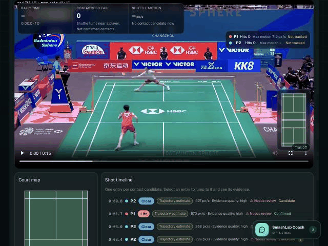
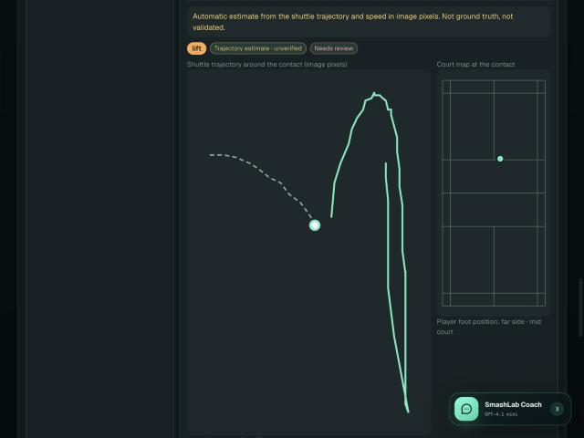
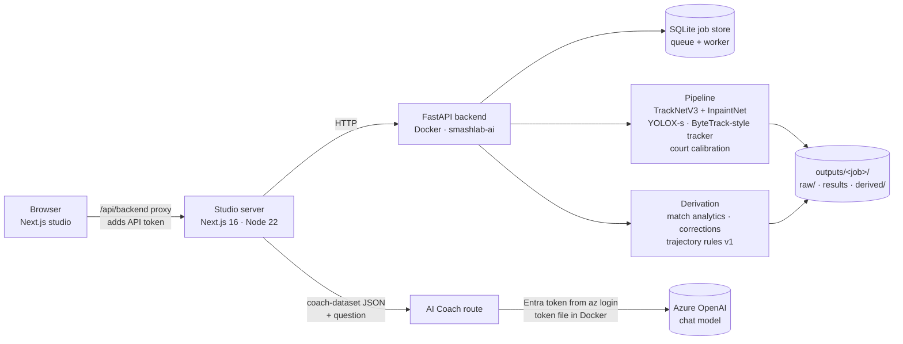

# SmashLab

SmashLab is an offline badminton video analysis studio. You analyse a match or training clip on your own computer. A local Docker backend tracks the shuttle and the players, writes an annotated video and structured data, and the studio shows the results with timestamps and frame numbers. An AI Coach answers questions from that data only.



| Video analysis and timeline | Trajectory estimate drawer |
|---|---|
|  |  |

> **Status: research prototype.** Every shot label is a rule-based **trajectory estimate · unverified**. Nothing in SmashLab is validated against ground truth yet. Coverage and detection counts are not accuracy scores.

## What it does

- **Video analysis.** Upload an MP4 or MOV (up to 200 MB and 120 s), or pick one of four test samples. Progress is shown stage by stage.
- **Tracking.** TrackNetV3 with InpaintNet finds the shuttle. YOLOX-s finds the people. Logical identities P1 to P4 follow court position and motion. Identities are never reassigned silently.
- **Court.** Automatic court calibration with a manual four-corner fallback. Floor-plane metres are shown only when the calibration is valid.
- **Shot timeline.** One row per contact candidate with its player, time, a six-class trajectory estimate (smash, clear, drop, drive, net shot, lift), image-space speed in px/s, evidence tier and quality, and a review status.
- **Evidence and corrections.** The original and the annotated video play in sync. Manual labels and corrections are stored apart from the raw output, and they are never applied automatically.
- **AI Coach.** Answers questions about the open analysis, grounded in its data and a short reference shelf. It receives derived numbers only, never video.
- **Sessions and evaluation.** Each sample is one session. Reanalysis creates a new job and never overwrites the old one. The evaluation panel reports measured values only.
- **Languages.** English, Vietnamese and German for all user-visible text.

## What it does not do

- It does not validate shot types, rallies or speeds. Speeds are image-space pixels per second, never km/h.
- It does not recognise faces. Identity uses court position, motion continuity and body appearance only.
- It does not score technique.

## Architecture



| Layer | Technology |
|---|---|
| Studio | Next.js 16, React 19, TypeScript (strict), CSS modules, Vercel AI SDK for the chat stream |
| Backend | Python 3.12, FastAPI, Uvicorn, SQLite job store, a background worker |
| Inference | ONNX Runtime (CPU), TrackNetV3 and InpaintNet (MIT), YOLOX-s (Apache-2.0) |
| Vision | OpenCV, NumPy, MediaPipe Tasks Vision (offline pose modules) |
| Video output | ffmpeg (bundled through `imageio-ffmpeg`), H.264 MP4 |
| AI Coach | Azure OpenAI through the `@ai-sdk/azure` provider |
| Deployment | Docker Compose project `smashlab-ai`, two services: `api` on port 8000, `web` on port 3002 |

Where things live:

- `backend/app/`: pipeline, analytics, API and services. `backend/tests/` holds the Python tests.
- `src/app/`: Next.js routes, including the server proxy `api/backend` and the chat route `api/ai/chat`.
- `src/components/`: the studio UI. `match-dashboard.tsx` is the timeline and the drawer. `local-ai-lab.tsx` is the video analysis page.
- `src/lib/`: client helpers, the match document types, the AI Coach instructions, and the copy for all three languages.
- `scripts/`: data and model download with checksums, the Azure token helper, and the end-to-end test.
- `docs/`: the trajectory rule set, the reference review, the local test report and the Azure deployment plan.

## Run it on your computer

These steps assume macOS or Linux with Docker Desktop. Expect about 3 GB of free memory for the backend container and a few GB of disk for the models and samples.

### 1. Install the prerequisites

- **Node.js 22** (20.9 or newer works) and npm.
- **Docker Desktop** with Compose v2.
- **Python 3.12**, only if you want to run the backend tests on the host.
- **Azure CLI** (`az`), only if you want the AI Coach. See the Coach section below.

### 2. Clone and install

```bash
git clone https://github.com/quocvietphung/badminton-smash-analyzer.git
cd badminton-smash-analyzer
npm install
```

### 3. Download the samples and the models

```bash
scripts/download-test-data.sh
```

This fetches the four Wikimedia Commons samples, trims them, and downloads the YOLOX-s and TrackNetV3 checkpoints. Every file is checked against its SHA-256. Check what is already present without network access:

```bash
scripts/download-test-data.sh --verify-only
```

The TrackNetV3 checkpoints are PyTorch files. The ONNX models used by the backend are exported from them. If the ONNX files are missing after the download, run `scripts/download-test-data.sh --export` with `backend/.venv-dev` set up (see the Verify section).

### 4. Start the backend

```bash
docker compose -p smashlab-ai -f docker-compose.yml up -d --build
curl http://localhost:8000/health        # {"status":"ok"} when the models are loaded
```

The first build takes several minutes. The backend listens on `localhost:8000` only and accepts uploads only from the studio origin.

### 5. Start the studio

Development server with hot reload:

```bash
npm run dev
```

Open [http://localhost:3000](http://localhost:3000).

Or run the studio in Docker, which needs no Node.js on the host:

```bash
docker compose -p smashlab-ai -f docker-compose.yml up -d --build web
```

Open [http://localhost:3002](http://localhost:3002). The browser never sees the backend address or the API token. The studio server adds them.

### 6. Run your first analysis

1. Open **Video analysis**.
2. Choose sample **A · Singles rally** and press **Run AI Analysis**. Or upload your own clip.
3. When the job reaches **Completed**, scroll through the annotated video, the **Shot timeline** and the **Court map**.
4. Click a row of the timeline. The drawer shows the mini trajectory, the court position of the player, the scores of the six classes, the evidence tier and quality, and the job and rule version.
5. Open **Saved sessions** to see every sample with its active analysis. **Ask the coach** opens the Coach for that analysis.

### 7. Stop

```bash
docker compose -p smashlab-ai -f docker-compose.yml down        # keeps the database and outputs
```

Do not add `-v` unless you want to delete the job database volume.

## AI Coach (optional, Azure OpenAI)

The Coach uses your Azure OpenAI deployment through your own Azure sign-in. No API key is stored in this repository.

1. Create `.env.azure.local` in the project root (it is git-ignored):

   ```env
   AI_ASSISTANT_ENABLED=true
   AZURE_RESOURCE_NAME=your-resource-name
   AZURE_OPENAI_DEPLOYMENT=your-deployment-name
   AZURE_OPENAI_MODEL_LABEL=GPT-4.1 mini
   AZURE_OPENAI_CREDENTIAL=token-file
   AZURE_OPENAI_TOKEN_FILE=/run/azure-auth/token.json
   ```

2. Sign in once on your computer: `az login`.
3. Write the token file and keep it refreshed while you use the Coach:

   ```bash
   node scripts/azure-token.mjs            # refreshes every 5 minutes; Ctrl+C to stop
   ```

   The file is written to `.local/azure-auth/` (git-ignored) and mounted read-only into the `web` container. Expired tokens fail closed.
4. Restart the `web` service if you changed `.env.azure.local`:

   ```bash
   docker compose -p smashlab-ai -f docker-compose.yml up -d web
   ```

For the development server on port 3000, set the same variables in `.env.local`. The server then uses your `az` sign-in directly, and the token helper is not needed.

Without this setup the Coach shows "unavailable" and the rest of the studio works normally.

## Verify

```bash
npm run lint
npm run test:vision
npm run test:rag
npm run test:local-ai
npm run build

cd backend
python3.12 -m venv .venv-dev && .venv-dev/bin/python -m pip install -r requirements-dev.txt
.venv-dev/bin/python -m pytest

cd ..
scripts/run-local-test.sh --no-build    # end-to-end test against the running Docker stack
```

## Branches

- `master`: the stable line. Releases are tagged here.
- `develop`: integration. Feature work is merged here first, then into `master` when it is ready.

## Documentation

- [docs/SHOT_TRAJECTORY_RULES.md](docs/SHOT_TRAJECTORY_RULES.md): the six-class rule set, its evidence tiers and review status.
- [docs/REFERENCE_REVIEW.md](docs/REFERENCE_REVIEW.md): the licence and reuse decision for every source that was read.
- [docs/LOCAL_AI_TEST_REPORT.md](docs/LOCAL_AI_TEST_REPORT.md): measured runtimes, the test log, and the known limitations.
- [docs/SECURE_REMOTE_ACCESS.md](docs/SECURE_REMOTE_ACCESS.md): remote access and the site password.
- [docs/AZURE_DEPLOYMENT_PLAN.md](docs/AZURE_DEPLOYMENT_PLAN.md): an Azure deployment plan. It is not deployed.

## Licence

MIT. See [LICENSE](LICENSE). Third-party components, models and sample footage keep their own licences; see [THIRD_PARTY_NOTICES.md](THIRD_PARTY_NOTICES.md).
